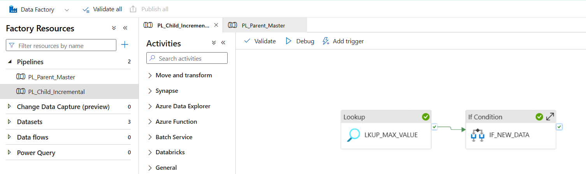
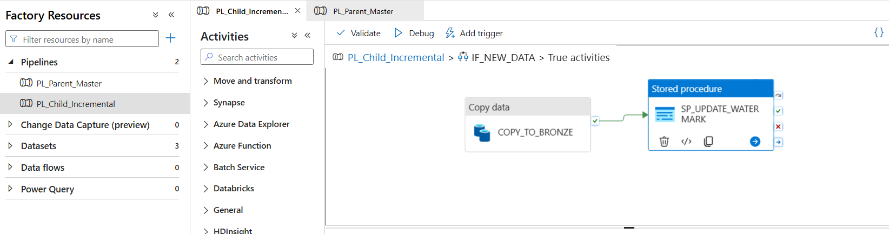
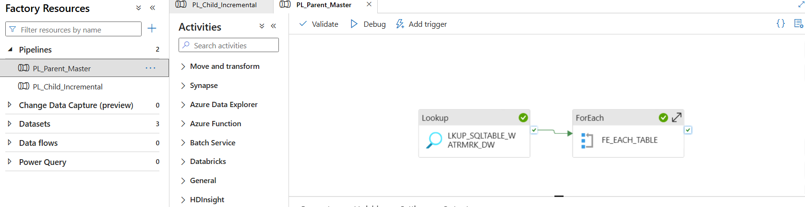
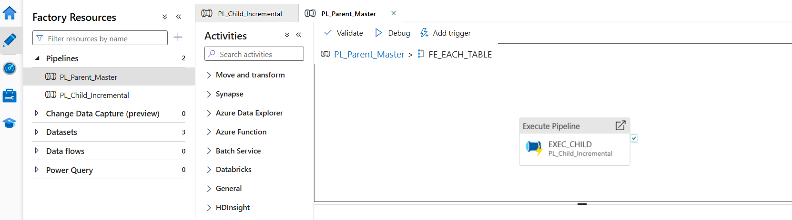
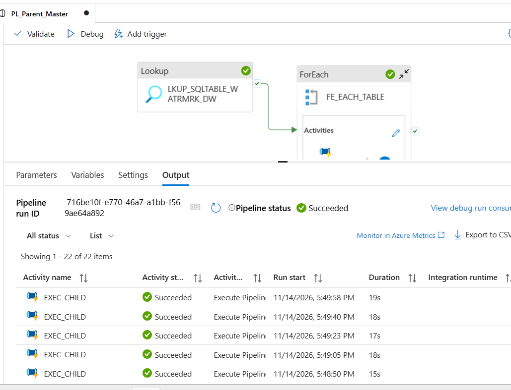
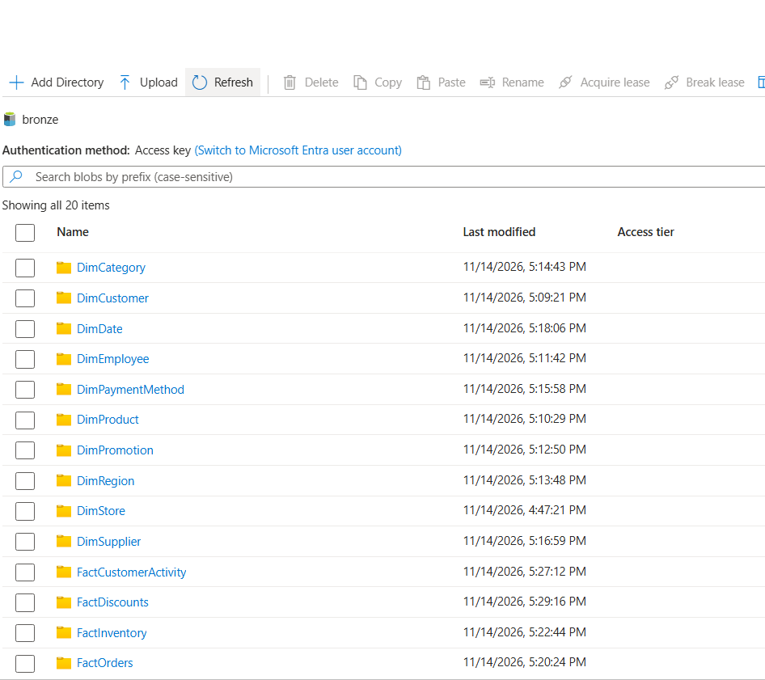
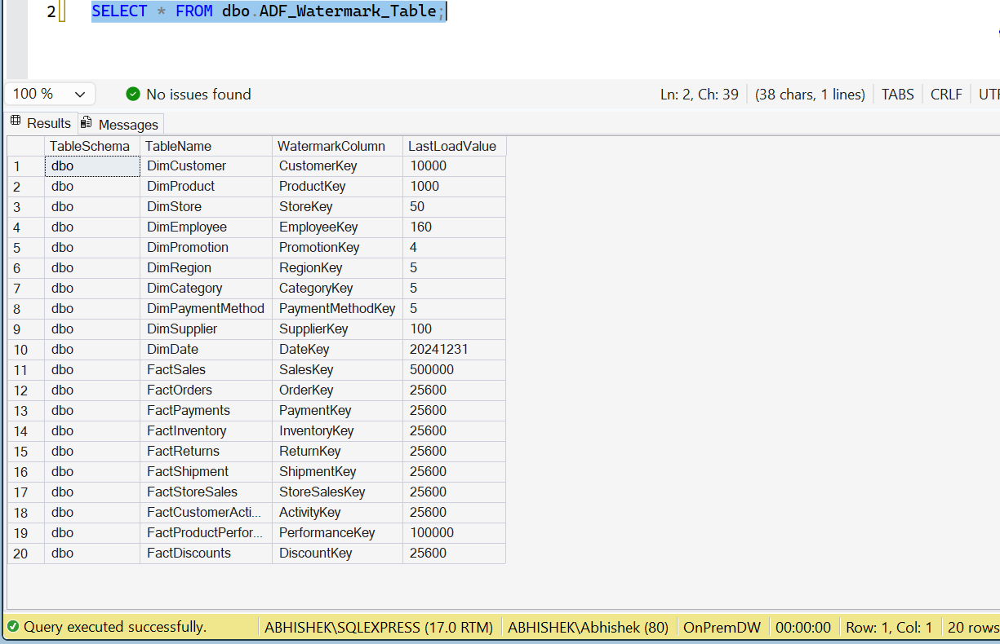
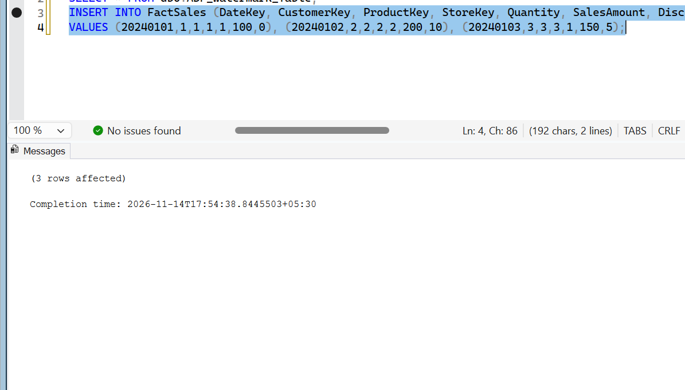
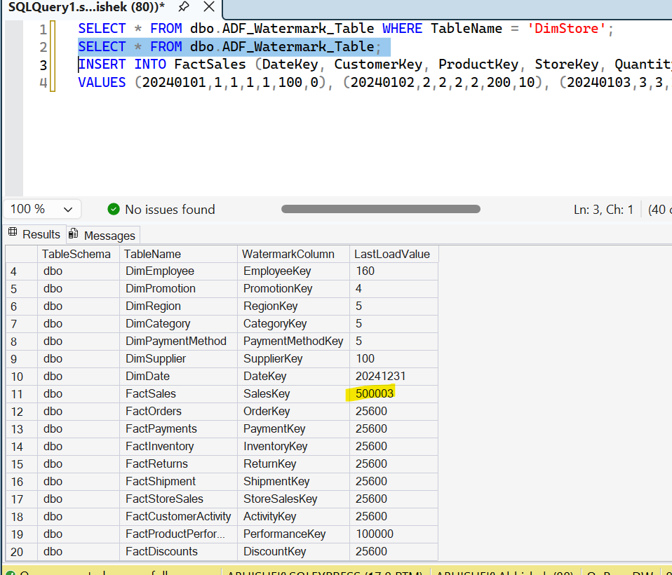

# Metadata-Driven Incremental Load: On-Prem SQL Server to ADLS Gen2 with Azure Data Factory

An end-to-end Azure Data Factory pipeline that moves 20 SQL Server tables (about 818K rows) from an on-premises database to Azure Data Lake Storage Gen2 as date-partitioned Parquet files. It uses a **watermark control table**, so after the first run only new records are copied.

> **Status:** Ingestion layer (SQL Server to ADLS Bronze) is complete and tested. The Databricks Silver/Gold layer is planned (see [Roadmap](#roadmap)).

---

## Architecture

```
SQL Server (OnPremDW)        Self-Hosted IR          Azure Data Factory              ADLS Gen2
 10 Dim + 10 Fact   ----->   (Windows VM)   ----->   Parent: Lookup -> ForEach  --->  bronze/<table>/yyyy/MM/dd/
 + ADF_Watermark_Table                                Child: Lookup MAX -> IF         <table>_<timestamp>.parquet
                                                            -> Copy -> Stored Proc
```

| Component | Purpose |
|---|---|
| SQL Server Express (on a Windows VM) | Simulated on-premises source with a star-schema database |
| Self-Hosted Integration Runtime | Secure bridge between the on-prem network and ADF |
| Azure Data Factory | Orchestration, data movement, parameterised pipelines |
| ADLS Gen2 (`bronze` container) | Landing zone for Parquet files |
| `dbo.ADF_Watermark_Table` | Control table storing the last loaded key for each table |

---

## How the Incremental Logic Works

**Parent pipeline (`PL_Parent_Master`)**
1. **Lookup** reads `TableSchema, TableName, WatermarkColumn, LastLoadValue` for all 20 tables from the control table (First row only = off)
2. **ForEach** (batch count 2) loops over the tables and calls the child pipeline with `@item()` values

**Child pipeline (`PL_Child_Incremental`)**
1. **Lookup** gets `MAX(<watermark column>)` from the source table
2. **If Condition** continues only if the watermark is NULL or the source max is greater than `LastLoadValue`
3. **Copy activity** runs `SELECT * FROM <schema>.<table> WHERE <watermark column> > '<LastLoadValue>'` and writes Parquet to `bronze/<table>/yyyy/MM/dd/`
4. **Stored procedure** `dbo.UpdateWatermark` records the new watermark

Datasets and pipelines are fully parameterised, so adding a table means inserting one row into the control table and nothing else.

---

## Results

| Test | Result |
|---|---|
| First full run | All 20 tables copied, 20 child runs succeeded |
| Re-run with no source changes | Every table skipped by the If Condition, no new files written |
| Inserted 3 new rows into `FactSales` | `FactSales` went from 500,000 to 500,003. Only the 3 new rows were copied and no other table loaded. |

### Screenshots
| | |
|---|---|
| Pipeline |  |
| Pipeline |  |
| Pipeline |  |
| Pipeline |  |
| Successful run |  |
| Bronze folders |  |
| Watermark table (before) |  |
| New rows inserted |  |
| Watermark table (after) |  |

---

## Setup

1. Run `01_OnPremDW_setup.sql` in SSMS. It creates the `OnPremDW` database, 20 tables, the watermark table, the `UpdateWatermark` procedure and the sample data.
2. Create an ADLS Gen2 storage account (hierarchical namespace on) with `bronze`, `silver` and `gold` containers.
3. Create an Azure Data Factory and install a Self-Hosted Integration Runtime on the machine that can reach SQL Server.
4. Create the linked services (SQL Server through the SHIR, ADLS Gen2), the datasets and the two pipelines described above.

**Note:** Writing Parquet through a Self-Hosted IR requires a **Java runtime** on the SHIR machine with `JAVA_HOME` set.

---

## Problems Solved

| Problem | Cause | Fix |
|---|---|---|
| Copy failed with `JreNotFound` | Self-Hosted IR needs Java to write Parquet | Installed a JDK, set `JAVA_HOME`, restarted the SHIR service |
| ForEach failed with `InvalidTemplate` (property `value` doesn't exist) | Lookup had "First row only" enabled, so there was no `value` array | Turned off "First row only" on the Lookup |
| SHIR showed "reconnecting" | It was still registered to a previous Data Factory | Reinstalled and registered it to the new factory |
| SQL script failed to run | Heading lines in the source scripts were not valid SQL | Commented them out and merged the scripts into one ordered file |

---

## Known Limitations and Improvements

- **Watermark on a surrogate key:** this catches new inserts but **not updates** to existing rows. For updates, use a `ModifiedDate` column, SQL Change Tracking or CDC.
- **Race condition:** `UpdateWatermark` re-queries `MAX(key)` after the copy, so rows inserted during the copy window could be skipped. A safer design passes the Lookup's `MaxValue` into the procedure.
- **Credentials:** the linked service uses a storage account key for simplicity. Production should use Managed Identity or Azure Key Vault.
- The source is a single laptop VM, so this demonstrates the design at small scale, not a production-size migration.

---

## Roadmap

- [ ] Databricks Silver layer: read Bronze Parquet, clean and de-duplicate, write Delta tables with `MERGE`
- [ ] Gold layer: business aggregations (sales by store, category and month)
- [ ] Databricks Notebook activity inside the ADF pipeline
- [ ] Pass the Lookup's `MaxValue` to the stored procedure to remove the race condition
- [ ] Alerts on pipeline failure, plus Key Vault for credentials

---

## Tech Stack

Azure Data Factory, Azure Data Lake Storage Gen2, Self-Hosted Integration Runtime, SQL Server, T-SQL, Parquet

---

## Author

**Abhishek Maradana** · [LinkedIn](https://www.linkedin.com/in/abhishek-maradana-80a272262)
